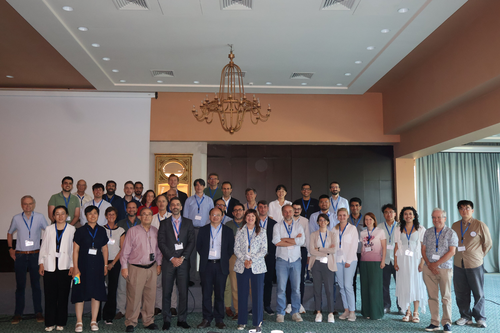

> [!Info]+ CSM9 2026
> 9th International Conference on Computational Stochastic Mechanics, under the aegis of IASSAR.  
> Corfu, Greece — **21–25 June 2026**.

Last week, I had the pleasure of attending my first **Computational Stochastic Mechanics (CSM9)** conference in Corfu, magnificently organized by Jianbing Chen, Ioannis Kougioumtzoglou, and Antonina Pirrotta.

The single-session format truly fostered meaningful discussions, making it easier to engage with the presentations, exchange ideas, and connect with researchers from all over the world. I especially appreciated the many inspiring conversations and discussions that made this conference such a rewarding experience.

I would like to sincerely thank my supervisors, Marco Broccardo, Bruno Sudret, and Stefano Marelli, for giving me the opportunity to attend this conference and present our first work, "**Reliability and Resilience Assessment via Spectral Properties of Continuous-Time Markov Chains**", developed within the MSCA [REACTIS project](/projects/reactis/).

This was an inspiring first CSM experience, and I look forward to future editions!

## Book of Abstracts

C. Nardin, S. Marelli, M. Broccardo & B. Sudret —  
**Reliability and Resilience Assessment via Spectral Properties of Continuous-Time Markov Chains**  
*CSM9 — 9th International Conference on Computational Stochastic Mechanics*, Corfu, June 2026.

[⬇ Download the Book of Abstracts (PDF)](/papers/2026-CSM9-Abstracts.pdf)

---

*CSM9 conference participants, Corfu — June 2026.*
